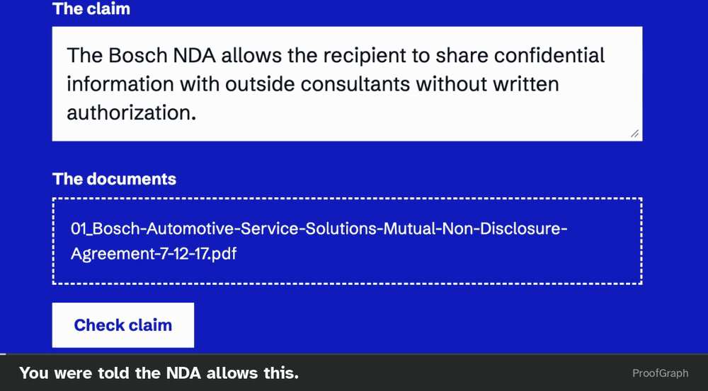
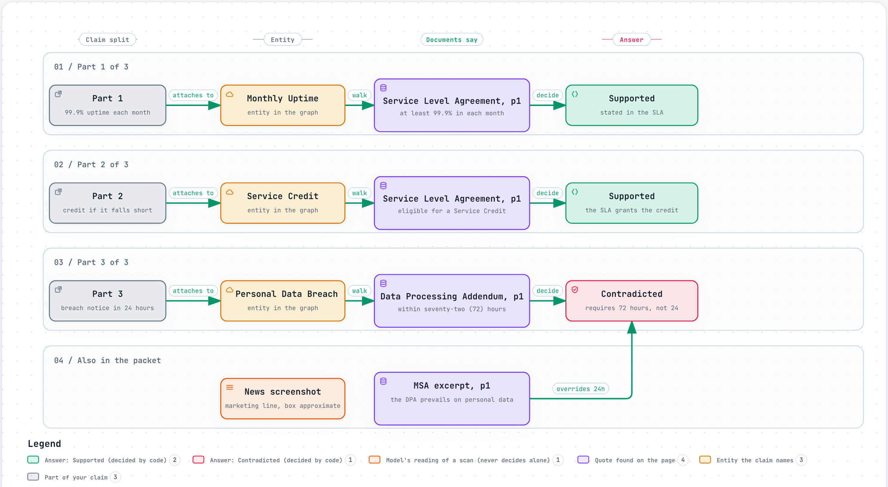
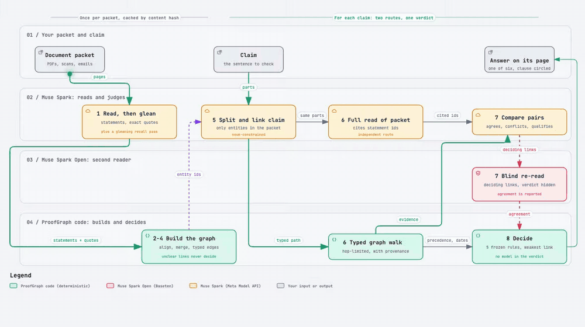
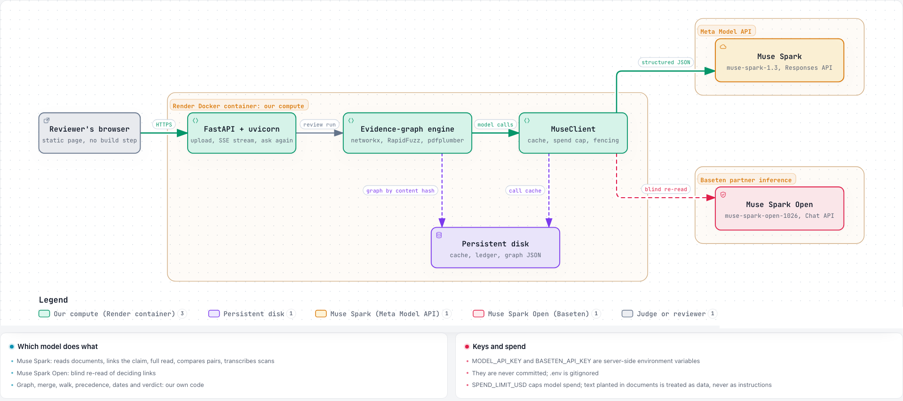
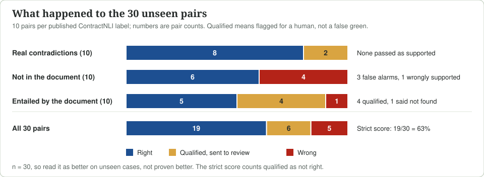

# ProofGraph

**Where does it say that?** ProofGraph checks a claim against every document in the packet and opens the clause that decides it, on its page.

Live: <https://proofgraph-orww.onrender.com/> (open it and choose **See the worked example**; no account, no key, no upload). Offline: [`docs/recorded/worked-example-review.html`](docs/recorded/worked-example-review.html) is the same review saved as one self-contained page; download it and open it in a browser, no key and no network needed.

[](docs/media/hero.mp4)

*The review screen on a claim about a real NDA (case TC40, from ContractNLI, CC BY 4.0, Koreeda and Manning 2021): each clause that goes against the claim is circled on its page. [Full-quality video](docs/media/hero.mp4).*

> **Meta's Muse Spark does the reading and judging; ProofGraph checks every statement against the page.** About 99% of the 1,496 statements it extracted were found on the real page, exactly or after whitespace and punctuation normalisation. On 30 contract pairs never used while building it was right on 19, qualified 6 for a human to review, and wrong on 5; none of the 10 real contradictions was passed as supported. Moving judgement from hand-coded patches to model-labelled fixed taxonomies fixed 10 unseen pairs and broke none. Answers resting on text read from the page: 13 right out of 15, none wrongly supported. Small samples: read as *better on unseen cases*, not *proven better*. [Results](#results).

## What it does

People trust an answer as far as they can see what it came from. Hand ProofGraph a sentence ("The recipient may share confidential information with outside consultants without written authorization") and a packet of documents. It splits the claim into parts, checks each part against every document, and answers each part with one of six words:

| Answer | Meaning |
| --- | --- |
| Supported | Statements match, nothing conflicts, no exception applies |
| Contradicted | A rule clashes with the part, including a claim that denies an exception's condition |
| Qualified | Support exists, but an exception or condition is attached |
| Not found | The documents discuss the thing but never say this, and a full read found nothing either |
| Unknown | No document mentions the thing at all |
| Documents disagree | Two documents clash and nothing decides which wins |

Each answer opens the deciding clause on its page, shows the path the reasoning took, and says which document wins and from when.

**Worked example (the one on the live app).** A synthetic packet (every name invented): a subscription agreement excerpt, the service-level schedule, the data-processing addendum, a scanned October service report and a news screenshot. Claim: *"The SLA commits Nimbus to at least 99.9% uptime each month, we can claim a service credit if it falls short, and Nimbus must notify us of any personal data breach within 24 hours."*

ProofGraph splits it into three parts. **Part 1 is Supported**: the service-level schedule promises at least 99.9% in each month, a quote found on the page. **Part 2 is Supported**: the same schedule grants a service credit when uptime falls short. **Part 3 is Contradicted**: the data-processing addendum requires notice within 72 hours, and the agreement excerpt says the addendum prevails on personal data, so the 24 hours in the claim loses. The news screenshot also mentions credits; it is a model-read line, labelled approximate, and never decides. Two parts hold and one fails, so the claim as a whole does not.



*Interactive version: [docs/diagrams/worked-example.html](docs/diagrams/worked-example.html) (download and open).*

## Why a sceptic can believe it

Fastest to check first:

1. **The page.** The deciding clause, circled on the real page.
2. **The path.** For example Personal Data Breach, then the data-processing addendum, page 1: the reasoning a careful reviewer would write out.
3. **The override.** Which document wins, and from when.
4. **The honesty.** "Not in these documents" and "cited, not in the packet" are answers, not failures.
5. **How each link was made.** *Read from the page* (code verified the quote), *the model's reading*, or *unclear*. An unclear link never decides an answer, and an answer is only as strong as its weakest link.
6. **Two routes agree.** A typed graph walk and one full read of the packet run side by side. "Not found" needs both to come back empty.
7. **Measured, not asserted.** The wrongly-supported rate on held-out cases.

## How it works

ProofGraph is neuro-symbolic, and the models carry the language work: Muse Spark is called at four of the eight steps (reading, claim linking, the full read, pair comparison) and Muse Spark Open re-reads deciding links. Code builds the graph, checks every quote against the page, and runs a small frozen verifier over the models' labels. The graph and the decision logic are deterministic; the contents of the graph are probabilistic, and every probabilistic piece is labelled.

| # | Step | Done by | Technique |
| --- | --- | --- | --- |
| 1 | **Read** each document once into rule-shaped statements (who is bound, must / may / must-not / fact, action, value, effective date, exact quote). Exceptions become linked statements. One *gleaning* recall pass asks what was missed. | Muse Spark | Information extraction, schema-constrained JSON |
| 2 | **Align** every quote to its page: exact, then normalised, then fuzzy, else unmatched. Offsets and word boxes are kept. | Code | Deterministic string alignment |
| 3 | **Merge entities** through defined terms, party names and section numbers. A number veto stops section 3.2 merging with 3.3. Look-alike names become "unclear" links, never merges. | Code | Rule-based record linkage |
| 4 | **Link** with typed edges: mentions, same as, is a, holds office, defined by, refers to, defeats, conditions, overrides, cites. Every edge carries its tier and evidence. | Code, checked against quotes | Typed knowledge graph |
| 5 | **Link the claim**: split into parts, each attached only to entity ids and rule types that exist in the packet. | Code, then Muse Spark constrained to an enum | Entity linking, constrained decoding |
| 6 | **Retrieve two ways in parallel**: a typed path walk and one full read of the packet that cites statement ids. | Code and Muse Spark | Hybrid retrieval with a long-context read |
| 7 | **Compare, then re-read** pairs of statements (agrees, conflicts, qualifies, irrelevant, unsure). A second model re-reads deciding links (a capped number per claim) without seeing the verdict. | Muse Spark, then Muse Spark Open | Pairwise entailment (NLI) |
| 8 | **Verify and decide**: a small frozen verifier combines the models' labels with structure, precedence and dates. The weakest link sets the confidence label. | Code | Symbolic, defeasible deontic reasoning |

The verifier is deliberately small, five rules over the models' labels: a rule cannot establish a fact about an instance; an exception defeats its rule only when it applies to this case; an extracted override wins, otherwise the later document of the same role, otherwise a declared governance order, otherwise "documents disagree"; time claims compare event dates; and the weakest link sets the label. No rule in code names a document type, a domain, a synonym or a case.

[](docs/media/pipeline.webm)

*Animated: [full-quality video](docs/media/pipeline.webm), [static image](docs/img/pipeline.png). Each node links to its code in the interactive version: [docs/diagrams/pipeline.html](docs/diagrams/pipeline.html) (download and open).*

The graph is built once per packet and cached on the packet's content hash, so a second claim on the same packet answers in seconds.

**A span-grounded evidence graph, not GraphRAG.** No summaries, no embeddings, no vector store, no graph database. Each packet's graph is one JSON file. More in [docs/evidence-graph.md](docs/evidence-graph.md).

## Meta models: which, where, and for what

| Model | Runs on | Used for |
| --- | --- | --- |
| **Muse Spark** (`muse-spark-1.3`) | Meta Model API | Step 1 reading and gleaning pass; step 5 claim splitting and enum-constrained linking; step 6 full read; step 7 pairwise comparison; transcription of scanned pages with a box per line |
| **Muse Spark Open** (`meta-models/muse-spark-open-1026`) | Baseten (partner inference) | Step 7: a blind second reader of deciding links, capped per claim. It never sees the relation or the verdict. The review page reports how many were re-read and how many it confirmed. |

All graph building, alignment, merging, walking, precedence, dating and the final verdict run on our own compute (a Docker container on Render, or your machine). Every model call goes through one client with a disk cache, a spend cap, and fencing against instructions planted in documents.



*Interactive version, with source links per component: [docs/diagrams/where-it-runs.html](docs/diagrams/where-it-runs.html).* Muse Spark Open shares Muse Spark's lineage, so we measure its independence (the agreement table in [results/health.md](results/health.md)) rather than assume it.

*Built for Best Build on Meta Open Weight Models: the second reader is Muse Spark Open on partner-provided inference.*

## Results

**What the numbers say, first.** Everything here is measured on recorded runs you can open ([`runs/`](runs/), [`results/`](results/)). The first three are the ones that matter.

| Result | Evidence | Why it matters |
| --- | --- | --- |
| **About 99%** of the statements Muse Spark extracted were found on the real page, exactly or after whitespace and punctuation normalisation | 1,496 statements on the suite (7 unmatched) and 1,192 on the held-out contracts (9 unmatched); unmatched ones are kept as unclear and never decide | The model is not inventing quotes |
| **92%** of the gold evidence became a statement | First full run: 73 gold relations | The model reads what matters |
| **0 of 10** real contradictions passed as supported | 30 unseen pairs, 10 per published label | The error that costs a reviewer money did not happen |
| **10 fixed, 0 broken** when hand-coded patches gave way to model-labelled judgement under fixed label sets | 30 unseen pairs, 9/30 to 19/30 | The approach generalises; it is not tuned to cases |
| **13 of 15** right, none wrongly supported, when the answer rests on text read straight from the page | 26-case suite, by trust tier (small n) | A reviewer can trust the green tier |



### The held-out check in full

30 ContractNLI pairs, scored against the dataset's published labels. Gold labels are read only by the evaluation scripts, never by product code. Iteration 2's design is written down before its code in [`results/preregistration-iteration-2.md`](results/preregistration-iteration-2.md), from the 29-case suite's failures; this held-out check is the number we treat as unbiased.

**How the 30 came out.** 19 right (63%). 6 qualified: the answer carries a caveat and goes to a human instead of showing a green or red verdict. 5 wrong: 3 false alarms (a contradiction flagged in a document that is silent), 1 wrongly supported (cnli-85), and 1 "not found" for a claim the document supports. The strict score below counts qualified as not right.

| System (n = 30) | Correct | 95% Wilson interval | Wrongly supported |
| --- | --- | --- | --- |
| Same pipeline with the graph switched off (baseline) | 15/30 (50%) | 33 to 67% | 2/20 (10%) |
| Hand-coded patches (run 1, the ablation) | 9/30 (30%) | 17 to 48% | 0/20 |
| **ProofGraph (iteration 2, shipped)** | **19/30 (63%)** | **45 to 78%** | **1/20 (5%)** |

**Why the patches row matters.** Run 1 let hand-coded code patches decide each case we had seen fail. That scored 9 of 30 on unseen pairs, worse than no graph. Iteration 2 threw the patches out. It asked Muse Spark to judge under fixed label sets (does this statement address the claim part; does it agree, conflict or not mention it; does an exception apply; which of ten event types is this) and kept only a small frozen verifier in code, with no rule naming a document type, a domain or a case. It scored 19 of 30 and got 10 pairs right that run 1 got wrong, and none the other way. The models handle the variety of contract wording; code only reads their labels and checks them against the page.

**What got worse, and the one miss.** Three pairs broke (cnli-62, 157, 289): all are exceptions that agree with the claim, a known limit (see [Limitations](#limitations)). The one wrongly supported answer (cnli-85) read a blank-template statement as supporting "all information shall be expressly identified".

### Why you can believe the green tier

- **Calibrated.** Answers decided by statements read straight from the page: 13 of 15 right, none wrongly supported.
- **Faithful to the page.** Across the 29 graphs of the first full run and 1,496 statements, 84% were read from the page, 15% were the model's reading, and 0.5% (7) could not be aligned and were marked unclear, so they never decided anything.
- **Honest abstention.** "Not mentioned" cases were 3 of 3 on the suite.
- **Nothing dropped silently.** 165 list members not found in their quote, 29 relations whose names were not in the quote, and 2 ambiguous override targets were each rejected and counted. Instructions planted in two packets were kept out of the rules.

### The 26-case suite (labelled after error analysis)

Used to find failures, so not unbiased: 12 of 26 correct against 9 of 26 without the graph. Sources: 8 LegalReasonBench cases, 8 ContractNLI, 2 Pepperwind cases and 8 multi-document packs. The first full run had 29 cases; 3 whose source licence we could not confirm were dropped and the suite figures recomputed from the recorded runs, so the analysis files in `results/` still report the 29-case run; see [Data and licences](#data-and-licences).

## Recorded runs

The hosted app runs the same code. For anything you cannot rerun without a key, the evidence is in the repo:

| What | Where |
| --- | --- |
| Per-case review output of every suite run (flag off, run 1, run 2) | [`runs/review-off.jsonl`](runs/review-off.jsonl), [`runs/review-on.jsonl`](runs/review-on.jsonl), [`runs/review-on-2.jsonl`](runs/review-on-2.jsonl) |
| The 30-pair held-out check, graph on and off, and the run-1 ablation | [`runs/clean-on.jsonl`](runs/clean-on.jsonl), [`runs/clean-off.jsonl`](runs/clean-off.jsonl), [`runs/clean-on-run1.jsonl`](runs/clean-on-run1.jsonl) |
| Analysis, with the pre-registered criteria for iteration 2 | [`results/run2-analysis.md`](results/run2-analysis.md), [`results/run2-suite-analysis.md`](results/run2-suite-analysis.md), [`results/preregistration-iteration-2.md`](results/preregistration-iteration-2.md) |
| Health lines (quote alignment, rejections, first read against second reader, walk against full read) and the error split (graph missed the evidence, or reasoning misjudged it) | [`results/health.md`](results/health.md), [`results/error-split.md`](results/error-split.md) |
| The full review page of the worked example, saved as one self-contained file (page images included; the live app's "ask another claim" box does not work offline) | [`docs/recorded/worked-example-review.html`](docs/recorded/worked-example-review.html) |
| A live trace of one packet | Open the live URL and choose **See the worked example** |

The three suite cases whose source licence we could not confirm have been removed from these files. The analysis files in `results/` still describe the original 29-case run.

## Limitations

| Limitation | Evidence |
| --- | --- |
| An exception that agrees with the claim is treated as a caveat | Held-out 0/7 on exception cases |
| Overrides across documents rarely decide | Suite 2/7 |
| Normative claims backed only by facts can be wrongly supported | The one suite case, TC17: "served from May 7" read as "authorized from May 7" |
| Emails, image pages and table rows are often not reached | 92% of gold evidence extracted, 73% reached by the walk |
| Small samples | n = 26 and n = 30, intervals overlap |

Out of scope, and said so on screen: arithmetic across many figures, law outside the packet (shown as "cited, not in the packet"), and subjective claims.

## Run it

You do not need an account to look: use the [live app](https://proofgraph-orww.onrender.com/) and its worked example. To run the code yourself:

```bash
git clone https://github.com/jhanvi0905/proofgraph.git && cd proofgraph
make setup            # uv sync, Python 3.11
make test             # 1,100+ tests, all offline, no key needed
```

**See a full review without a key:** open [`docs/recorded/worked-example-review.html`](docs/recorded/worked-example-review.html) in a browser.

**Offline command, no key, no network** (the earlier deterministic engine on a recorded fixture; prints a JSON verdict):

```bash
uv run python -m proofgraph tests/fixtures/synthetic_pm_packet.json
```

**The full app, with live model calls.** This needs a Meta Model API key:

```bash
cp .env.example .env          # .env is gitignored; never commit a key
# edit .env: set MODEL_API_KEY (Meta Model API) and BASETEN_API_KEY (Muse Spark Open, the second reader)
export $(grep -v '^#' .env | xargs)
PROOFGRAPH_GRAPH=1 PROOFGRAPH_SAMPLES=examples/samples/samples.json uv run uvicorn app.server:app --port 8000
```

Open <http://localhost:8000>; the app starts, and the worked-example packet appears on the entrance screen. Running a packet makes live model calls, so it needs the keys above; the hosted app already has its result cached. `SPEND_LIMIT_USD` in `.env` caps model spend (default 50). Without `BASETEN_API_KEY` the second reader does not run, so supported answers go unchecked by it. Without `MODEL_API_KEY` the app cannot read new documents; the live URL above can.

The reproduction scripts (`scripts/eval_review.py`, `scripts/report_review.py`, `scripts/analyze_run.py`) re-run or re-analyse the evaluation, but the evaluation documents are third-party datasets that we do not redistribute. See below.

## Built during the hackathon, and what it stands on

**Provenance.** The git history is the record: 260+ commits from 26 Oct 2026. The four commits before 27 Oct 00:00 IST are scaffold only (documents, licence, `.gitignore`); the first code commit is at 02:48 IST on 27 Oct (`git log --reverse --format='%h %aI %s' -- '*.py' | head -1`). The evidence graph, the review app and the evaluation scripts were written after that.

No code in this repository predates the build window; the only pre-existing code is the named dependencies below.

Not built here, used as named dependencies:

| Dependency | Licence | Used for |
| --- | --- | --- |
| networkx | BSD-3-Clause | The packet graph, typed walks and path enumeration |
| RapidFuzz | MIT | Fuzzy quote alignment and near-miss name detection |
| pdfplumber | MIT | PDF text and word boxes |
| FastAPI, uvicorn, python-multipart | MIT, BSD-3-Clause, Apache-2.0 | The server and uploads |
| pydantic, Pillow, openai SDK | MIT, MIT-CMU, Apache-2.0 | Typed contracts, page images, calling the model endpoints |
| Schibsted Grotesk, Source Serif 4 (Google Fonts) | SIL OFL | Typography |

Full list and attribution in [`NOTICE.md`](NOTICE.md). Earlier-engine code (a photo-counting path using SAM 3.1, a Streamlit front end, a freight example) remains in the tree for history and is not used by the demo.

**Ideas studied, no code copied:** LangExtract (source grounding), Graphiti (declared edge schema), LightRAG (gleaning pass), LazyGraphRAG, KAG, LegalRuleML and ContractNLI (label set).

## Data and licences

Code: MIT ([`LICENSE`](LICENSE)). No API key or secret is committed; `.env` is gitignored and only `.env.example` is tracked.

| Data | Licence | How it is used here |
| --- | --- | --- |
| **ContractNLI** (Koreeda and Manning, Findings of EMNLP 2021) | CC BY 4.0, attribution required, no share-alike. Documents were collected from SEC filings and search results; the dataset page does not address the rights status of the original documents, so we ship none of them. | Held-out check and suite. Published gold labels are used under the same licence. Suite documents are referenced by file name and hash, not redistributed. The hero clip shows one page of one NDA (TC40) with attribution; no other ContractNLI page is shown. |
| **LegalReasonBench** (micro1 public sample) | CC BY 4.0 per the dataset card. | Suite cases. Cite as: LegalReasonBench (micro1), <https://www.micro1.ai/benchmark/legal-reason-bench>. |
| Packets in `examples/` | Fictional, written for ProofGraph, MIT. | The worked example and the offline run. |

Labels and transcriptions derived from a dataset's images or documents fall under that dataset's licence, so the same status applies to them.

*ProofGraph checks a claim against documents. It does not give legal advice.*
