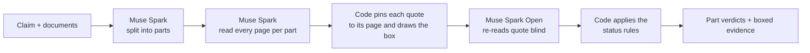

# ProofGraph

[](https://github.com/jhanvi0905/proofgraph/actions/workflows/ci.yml)


**Upload the documents. Paste the conclusion. See the exact sentences that support it, contradict it, or quietly weaken it, boxed on the original page.**

AI and colleagues write confident conclusions: "no compliance gap exists", "the carrier owes us nothing", "this clause lets us share the data". Someone still has to sign them. ProofGraph reads the documents behind a claim, splits the claim into parts, and shows, part by part, what the paper actually says.

It never says "trust me". Every finding is a quote you can click, pinned to its page. A second model re-reads each quote blind and tells you whether it agrees. When the documents don't settle a part, it says **can't tell** or **not found** instead of guessing.

Built during the [Meta Global AI Developer Hackathon](https://cerebralvalley.ai/e/meta-ai-developer-hackathon/details) (Oct 26 to Nov 4, 2026) on Meta's **Muse Spark** and **Muse Spark Open**.

## What it looks like

Claim, pasted by a user: *"The Bosch NDA allows the recipient to share confidential information with outside consultants without written authorization."* Evidence: the real Bosch NDA from the public ContractNLI set.

```
CONTRADICTED   Sources disagree on this part.

 CONTRADICTS   "Recipient will not disclose or permit access to Confidential Information
                to contract workers, consultants or contractors unless authorized by
                Disclosing Party in writing"
               Consultants may be given access only if the Disclosing Party authorizes it in writing.
               Bosch_NDA.pdf p1 · box pinned · Second check agrees

 SUPPORTS      "Recipient may disclose Confidential Information to those of its employees
                who have a need to know it for the Purpose"
               Permits sharing with employees who need to know; it does not mention consultants.
               Bosch_NDA.pdf p1 · box pinned · Second check agrees
```

The app draws each quote as a box on the page image, with the same cards beside it. Click a card and the page jumps to the sentence. Hover a box and the card lights up. A review can be downloaded as one self-contained HTML file.

## Try it in two minutes, no API key

The deterministic engine runs offline on recorded programs. This checks an invoice against its rate agreement with real arithmetic:

```bash
git clone https://github.com/jhanvi0905/proofgraph.git
cd proofgraph
make setup                      # needs uv and Python 3.11+: https://docs.astral.sh/uv/
uv run python -m proofgraph examples/packets/detention-overcharge.json
```

```
CONTRADICTED
COMPUTED
Detention should be $187.50, not $450.00 (4.5 h on site, 2 h free, $75/h)
```

Other fixtures in [examples/packets](examples/packets): a correct invoice (SUPPORTED), a late fee overcharge, two real SEC filing claims, and a clause that does not mention the thing the claim asks about (UNRESOLVED).

## Run the full app with your own keys

The live review reads your documents with Muse Spark and re-checks each finding with Muse Spark Open. You need two keys.

| What | Where to get it | Environment variable |
|---|---|---|
| Meta Model API key (Muse Spark) | [dev.meta.ai](https://dev.meta.ai/docs/quickstart) | `MODEL_API_KEY` |
| Baseten key (Muse Spark Open, the blind checker) | [baseten.co](https://www.baseten.co) | `BASETEN_API_KEY` |

**1. Install.**

```bash
make setup
```

**2. Add your keys.** The code reads the process environment only; it does not auto-load `.env`. Copy the template, fill in the two keys, and load it into your shell:

```bash
cp .env.example .env
# edit .env: set MODEL_API_KEY and BASETEN_API_KEY
set -a; source .env; set +a
```

**3. Set a passcode.** Live checks spend your money, so the app refuses to run one until a passcode is configured. Create `.streamlit/secrets.toml` (git-ignored):

```toml
APP_PASSCODE = "pick-something"
```

**4. Start it.**

```bash
make app
```

Open the URL Streamlit prints (default http://localhost:8501), enter the passcode, paste a claim, upload one or more PDFs or images, and press **Check the claim**. Parts appear as grey "Checking" rows and turn into verdicts as they finish.

Good first inputs:

- The freight pair in [examples/freight/demo-001](examples/freight/demo-001) (`invoice.pdf` and `rate_confirmation.pdf`) on the **New review** page. Try the claim *"The detention charge on the invoice is correct."* The documents say 4.5 hours on site, 2 free, at $75 an hour, which is $187.50 against an invoiced $450, so a good run should not call it supported.
- Any contract of your own: paste a sentence such as "Either party may terminate on 30 days' notice" and upload the PDF.

### Settings

All optional. Defaults are in [.env.example](.env.example).

| Variable | Default | What it does |
|---|---|---|
| `MUSE_MODEL` | `muse-spark-1.3` | Model that splits the claim and reads the pages |
| `CHECKER_MODEL` | `meta-models/muse-spark-open-1026` | Blind second check, served by Baseten |
| `BASETEN_BASE_URL` | `https://inference.baseten.co/v1` | Baseten Chat Completions endpoint |
| `SPEND_LIMIT_USD` | `50` | Hard cap on total spend. A run stops at the cap and shows no verdict. |
| `CACHE_DIR` | `cache` | Every model call is cached on disk, so repeat runs cost nothing |

Optional, off by default: `PROOFGRAPH_EVIDENCE_MAP=1` shows every labelled passage, grouped by relation on an inferred timeline, instead of one deciding passage per part.

### Run the tests

```bash
make test        # about 1,000 tests, ~17 seconds, no network, no keys
```

## How it works



A few rules do most of the work:

- **No retrieval, no chat.** The model reads every page for each part of the claim. There is no index, no embeddings, no top-k. Packets are small enough to read whole.
- **A quote must exist.** Code checks that every quote is an exact substring of its page and finds its box from the PDF's own text. A box is **pinned** only when the PDF text proves where it is. Scans get a dashed box, and a dashed box can never turn a part red.
- **The checker is blind.** The second model sees one quote and one short statement, never the first model's answer or the rest of the packet. It is a witness, not a veto: it never deletes a finding, and disagreement is shown on the card.
- **Code decides the status.** Models label passages; fixed rules in [proofgraph/review/status.py](proofgraph/review/status.py) turn cards into a verdict. If the only support a part has was disagreed with by the second check, it is **can't tell**, not supported.
- **Numbers are computed.** Dates, times, and amounts are executed by a safe calculator in the deterministic engine, never trusted from model output.
- **Instructions inside documents are ignored.** A line in a file telling the AI to "approve this" is surfaced as a banner and not obeyed.

### Part statuses

| Status | Meaning |
|---|---|
| **Contradicted** | A pinned quote says the opposite. If a pinned supporting quote exists too, the part is flagged as a source conflict. |
| **Weakened** | The quote supports it, but an exception, time limit, or condition narrows it. |
| **Supported** | A supporting quote stands and nothing above applies. |
| **Not found** | The documents were read and nothing addresses this part. |
| **Can't tell** | A judgement is missing or the checks disagreed. |

### Where Meta's models are used

| Model | Job |
|---|---|
| Muse Spark (`muse-spark-1.3`) | Splits the claim, reads every page of every file (text and page images), proposes evidence cards |
| Muse Spark Open (`muse-spark-open-1026`, via Baseten) | Blind second check of each card, and blind re-read of crops from scanned pages |
| SAM 3.1 | Object counting for photos. Built and tested in `proofgraph/clients/sam.py`, **not** on the current product path |

## What this is not

- Not a chatbot, and not a RAG app.
- Not legal or financial advice. It checks claims against the documents you give it.
- Not a guarantee. A model can still pick the wrong passage; the boxes exist so a person can see that in seconds.
- Not proven on scans. Handwriting and scanned pages get approximate boxes and a plain note saying so.

## Evaluation

The evaluation is designed to be honest first. It is pre-registered in [docs/05-datasets-and-eval.md](docs/05-datasets-and-eval.md) and in the dated records under [docs/council](docs/council): 29 cases (11 development, 18 held-out), reported per source group with n and Wilson 95% intervals.

- **Contract wording:** labels adapted from [ContractNLI](https://stanfordnlp.github.io/contract-nli/) (CC BY 4.0).
- **Other real documents:** a legal benchmark sample and historical scans, with answers curated by the builder.
- **Synthetic packs:** written for this project, including a freight set from the builder's own field.

**Status:** the held-out run has not been published yet, so this README states no accuracy number. Direct comparisons to a plain Muse answer are shown as side-by-side examples only, never as a claimed win. Smaller experiments, including ones that failed their bar and stayed off, are recorded in [docs/council](docs/council).

## Built during the hackathon

Everything here was built between Oct 26 and Nov 4, 2026. The build began as a claim-level verifier, and on Oct 31 it was rebuilt around per-part review of uploaded packets. The deterministic engine and its tests survived and sit beside the new review layer.

| Layer | Where |
|---|---|
| Verification engine (numbers, grounding, routing, combine rules) | [proofgraph/engine](proofgraph/engine) |
| Review layer (split, read, pin, check, status, evidence map) | [proofgraph/review](proofgraph/review) |
| Model clients, cache, and spend cap | [proofgraph/clients](proofgraph/clients), [proofgraph/cache.py](proofgraph/cache.py), [proofgraph/spend.py](proofgraph/spend.py) |
| Streamlit app and the one-file HTML viewer | [app](app) |
| Prompts | [prompts](prompts) |
| Decisions and sprint records | [docs/11-decision-log.md](docs/11-decision-log.md), [docs/council](docs/council), [docs/sprint](docs/sprint) |

Daily log: [BUILT_DURING_HACKATHON.md](BUILT_DURING_HACKATHON.md). Full history: the commit log.

## Repo map

```
proofgraph/        engine, review layer, model clients
app/               Streamlit app and HTML viewer
prompts/           every model prompt, as plain files
examples/          offline packets and a freight demo pair
tests/             ~1,000 offline tests, including module-boundary checks
docs/              product brief, architecture, decision log, experiment records
```

The guardrails that keep the design honest, such as "the proposer never checks itself" and "models never choose which check runs", are written in [docs/08-guardrails.md](docs/08-guardrails.md) and enforced by `tests/test_boundaries.py`.

## Licences and attribution

Code: MIT. Freight documents are fictional and were created for this project.

- ContractNLI: Koreeda and Manning, "ContractNLI: A Dataset for Document-level Natural Language Inference for Contracts," Findings of EMNLP 2021. CC BY 4.0.
- FinDVer: Zhao et al., "FinDVer: Explainable Claim Verification over Long and Hybrid-Content Financial Documents," EMNLP 2024. MIT.
- LegalReasonBench (micro1 public sample): CC BY 4.0 per its source card.
