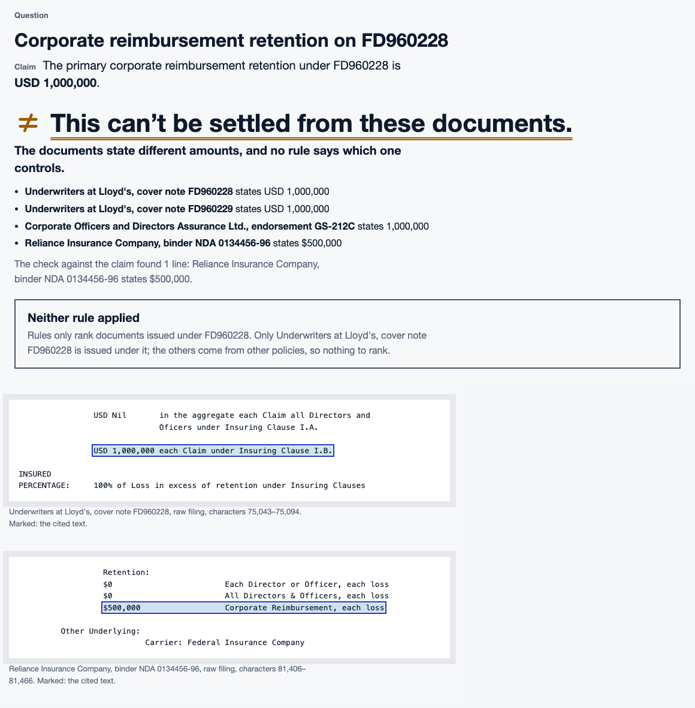

# ProofGraph

**Which document says what, and which one wins?** ProofGraph answers that for one claim against a packet of insurance documents (a policy, its endorsements, its binders), and shows the page and the exact words behind the answer.

- **Today:** a person reads every document in order, then makes a judgment call nobody writes down.
- **With ProofGraph:** an answer you can check in seconds, or a named reason it cannot answer.
- **The line it never crosses:** the model finds and quotes. Code compares and applies the rules. A model never decides which document wins.

**Not:** a document store, a coverage opinion or legal advice. Tested on two document sets: a 1996 D&O program filed with the SEC, and ISO homeowners forms.

**Bring your own claim** ([D11](DECISIONS.md)). Type any amount or wording claim. Code reads it; the for and against reads find lines in every document of that policy; a person confirms which lines are about the claim (or sets one aside, with a reason, shown on the result); the unchanged decision tree runs. The eight hand-written questions are now the regression test: typed as plain text, all five amount claims give the same answers ([results](results/d11_regression.md)).

## The answers

| Answer | When | Seen on real documents? |
|---|---|---|
| **supported** (right) | The controlling document states the claim's amount. | Yes: 8 family B packets. |
| **contradicted** (wrong) | It states a different amount. Both are shown. | Yes: jewelry claim $1,500 vs HO 00 15's $1,000. |
| **unresolved** (can't be settled), with one reason | `documents_disagree`: amounts differ, no rule picks one. | Yes: Gillette retention, $1,000,000 vs $500,000. |
| | `amounts_not_comparable`: currency or basis differs or is missing; the mismatch is named. | In tests only. |
| | `governing_instrument_absent`: an endorsement is here, the document it changes is not. | Yes: HO 00 15 without HO 00 03. |
| **not found** | No document addresses the question. | In a unit test only. |
| **quoted** | Wording claims. The controlling clause is quoted with its page, marked not checked. No verdict. | Yes: HO 00 15 item 5. |

Two amounts are compared only when both state the same currency, and either the same basis or none at all ([D9](DECISIONS.md)).

**Two precedence rules, nothing else** ([D3](DECISIONS.md)). Each applies only between documents issued under the question's policy.
1. **Endorsement over base form.** Fires in family B (HO 00 15 is printed "Form HO 00 03 Only"). Never in family A: its endorsements amend GS-212C, whose base wording is not in the packet ([D5](DECISIONS.md)).
2. **Later effective date over earlier.** Compares effective dates, never coverage periods.

No rule applies and the documents disagree? It refuses to pick.

## See it



- **Documents disagree (Gillette, public SEC filing).** Two Lloyd's cover notes and an endorsement state 1,000,000; the Reliance binder states $500,000 each loss. Only one is issued under the policy in question, so no rule can rank them: *unresolved*. Each value is marked in the raw filing.
- **A rule decides (ISO forms).** HO 00 03 says "$1000", HO 00 15 says "$1,000". Code compares them as equal; the endorsement rule names HO 00 15 as controlling. A string comparison would have called them a disagreement. The ISO forms are copyrighted, so the page renders live in the app, not here.

```bash
uv run uvicorn app.server:app --port 8765
```

Open http://localhost:8765.
- **Five worked examples** (right, wrong, can't be settled, base form missing, wording quoted) replay recorded model responses: no key, no cost.
- **Upload your own PDFs** with `ANTHROPIC_API_KEY` set. The model proposes what each file is from its printed form number, edition and title; code checks the quote is on the page; a person confirms every row. Name and time are frozen with the run ([D10](DECISIONS.md)).

## Run it

You need [uv](https://docs.astral.sh/uv/) and a network connection. No API key.

```bash
git clone https://github.com/jhanvi0905/proofgraph.git && cd proofgraph && git checkout x/proofgraph-v2-arbiter
```

```bash
uv sync
```

```bash
SEC_USER_AGENT="Your Name you@example.com" uv run pgrun demo
```

`pgrun demo`:
1. Fetches the source documents and refuses any whose sha256 differs. None is stored here. (SEC asks for a contact, hence `SEC_USER_AGENT`.)
2. Prints the verdict on the retention question.
3. Prints retrieval recall@10 on labelled queries.
4. Replays the support and attack passes from `data/recorded/model`.
5. Gives the pipeline's own verdict beside the hand-labelled one.

- `ANTHROPIC_API_KEY` makes new model calls instead.
- First run downloads `all-MiniLM-L6-v2` (pinned, ~90 MB); `uv sync` installs PyTorch.
- The ISO forms are copyrighted and not redistributed: `pgrun fetch` says where to save them and checks the hash.

## Who decides what

**A person writes:**
- the claim and its value (`data/claims.json`);
- which policy each document describes, with a cited scope and a strength (`data/document_mappings.json`). Fixed before the run, so it cannot be shaped to fit the answer.

**The model sees only:**
- text from documents mapped to the claim's policy, inside each mapping's scope (`admit()` in [`retrieve.py`](proofgraph/retrieve.py));
- one claim per pass (support or attack), never the whole packet ([`passes.py`](proofgraph/passes.py)).

**The model returns:** a passage id, an exact quote, the value copied from it, a one-line reading.

**Code does the rest:**

| Step | Model | Code |
|---|---|---|
| Atomise | splits the claim into a closed predicate set | validates every field; one repair, then fail |
| Retrieve | — | BM25 + local embeddings, fused by rank; ten admitted passages |
| Support / attack | picks a passage, quotes it | id must be one it was shown; quote must occur exactly once; citation verified against the file |
| Numbers | — | parses to integer minor units; `NIL` is not comparable |
| Verdict | — | the two rules; `unresolved` unless one picks a winner |

Every route carries a strength: **read** off the page, **derived** by code, or **judgment**. A judgment with no reasoning is rejected.

- **Every citation is checkable.** File hash, a locator (raw-file offsets, or page + quote occurring exactly once), the expected text, the extractor version. One verifier checks it against the source file, never against our own text conversion ([`checker.py`](proofgraph/checker.py)).
- **Closed vocabulary.** Predicates are frozen data; questions are keys in a registry, matched exactly (no aliases, no fuzzy matching). The model never names one ([`predicates.json`](data/predicates.json), [`slots.json`](data/slots.json)).
- **The pipeline matches the hand labels, and found more.** `pgrun derive` reaches the same verdict (*unresolved, documents disagree*) from four assertions instead of three: support found the FD960229 cover note restating the retention, which the hand labels missed.

**The measure is reviewer trust:** can someone check the answer without rereading the packet? Accuracy is reported with its denominator, but it is not the headline.

## How it is kept honest

Each guard has a test; counterfactual tests show what gets through without it.

| The model might… | Guard | Test |
|---|---|---|
| force "each claim" into a nearby allowed value (seen 1 of 2 runs) | bases kept as written; no equivalence without a cited span ([D6](DECISIONS.md)) | `test_numbers.py`, `test_arbiter.py` |
| copy words from prompt examples (2 of 2 runs) | examples outside insurance; a test scans prompts for packet literals | `test_no_family_literals.py` |
| cite a passage it wasn't shown | span ids are an enum; hard failure | `test_span_id_guard_counterfactual` |
| paraphrase a quote | exact occurrence required; 17 of 17 live quotes located | `test_exactly_once_guard_counterfactual` |
| let attack copy support | separate prompts; attack never sees support | `test_attack_is_blind_to_support` |
| get arithmetic wrong | the model never compares numbers | `test_numbers.py` |
| fill a field it can't source | unsourced fields are "not stated" ([D1](DECISIONS.md)) | `test_assertions.py` |
| force a claim into a predicate | "no predicate fits" is an outcome | `test_no_fit_is_an_outcome_not_a_repair` |
| pick a winner | no model in the arbiter | `test_later_effective_date_flips_the_verdict_when_reliance_is_in_scope` |

**Evaluation hygiene**
- **Labels first.** Retrieval queries and gold quotes committed (`baf5c04`) before any measurement.
- **Design vs independent queries reported apart.** Field labels helped an independent query (3/6 → 4/6); plural folding helped only design queries.
- **No tuning to known answers.** A synonym list written after reading both families was deleted before commit.
- **A frozen holdout.** The domain layer (arbiter, comparators, assertions, passes, predicates, slots, family A labels) is hashed before family B is labelled; `tests/test_freeze.py` fails on any change ([D8](DECISIONS.md)). Family B ran once: **8 of 8** matched preregistered labels; 2 of 5 predictions were wrong, optimistically. Under D9 those labels now match **5 of 8**: three were `resolved_by_rule` over equal amounts, which D9 calls a mislabel. Recorded tables unchanged ([results](results/family_b.md), [PREREGISTRATION.md](PREREGISTRATION.md)).

**Replay and cost**
- One JSON line per stage: served model, prompt hash, tokens, rejects, verdict (`runs/trace.jsonl`).
- Every response cached; a clean clone replays with no key.
- Cost from real token counts: support + attack on the retention claim ≈ $0.03.

## Limitations

| Limit | Today |
|---|---|
| Right/wrong only for amounts | Wording is quoted, never judged. |
| Missing-document check needs an `amends` route | Recorded by hand or read from an upload's printed line. Out-of-policy amendments (Gillette's Endorsement 13 → GS-212C) are listed as set aside, not checked. |
| Endorsement rule only on an assembled packet | Fired 3 of 3 on two ISO forms paired under a specimen policy; both state the same amount, so no value dispute has yet been settled by a rule. |
| Small sample | 20 packets (12 Gillette dev, 8 ISO holdout). Shows the design; not a rate. |
| Typed claims | A person confirms every grouping; pre-fill from past confirmations and auto-accept are not built. Dates are refused (no comparator). Checked live on the worked packets and one upload of the ISO forms; no third packet yet. Proposer checked on the two ISO forms only. No public API. |

## Repo map

- [`DECISIONS.md`](DECISIONS.md): numbered design decisions, cited by the code.
- [`DEFERRED.md`](DEFERRED.md): found and deliberately left, with reasons.
- [`data/SOURCES.md`](data/SOURCES.md): both document sets, read from the files.
- [`results/family_b.md`](results/family_b.md): the holdout run.
- Earlier version (ContractNLI evidence graph): git history up to `14264f0`.
